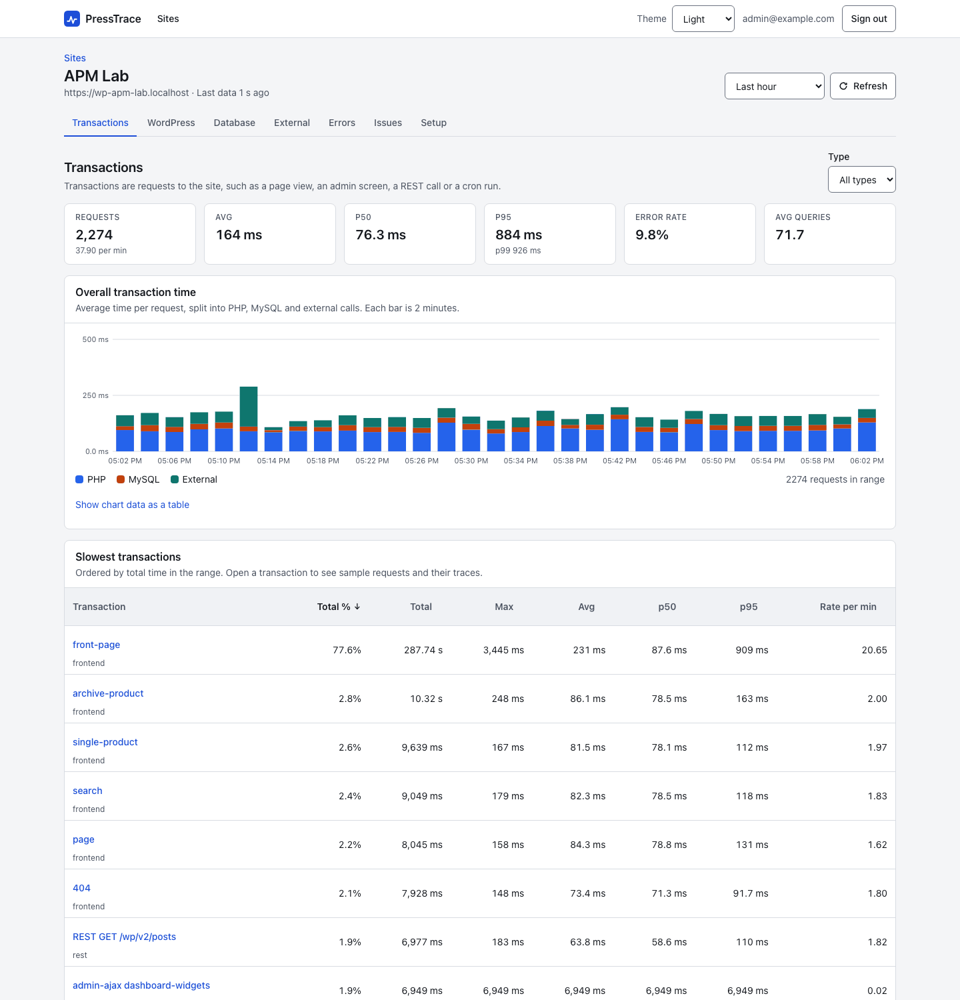
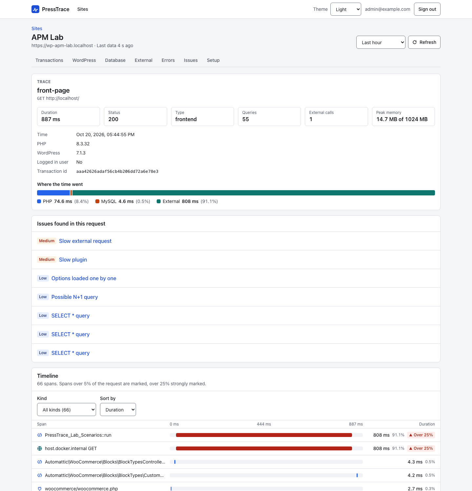
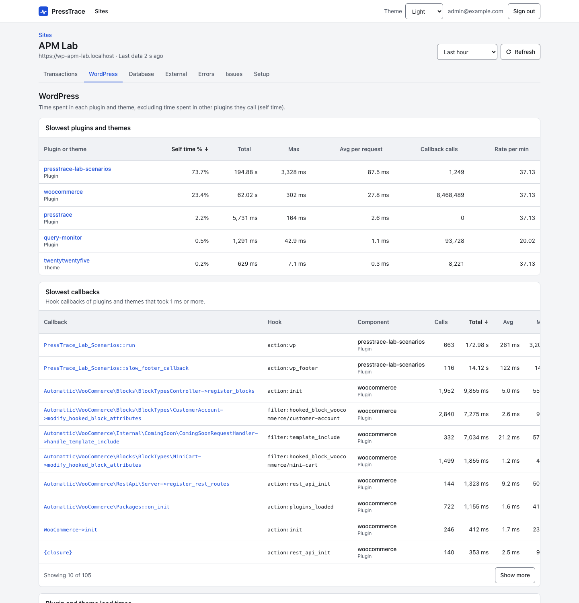
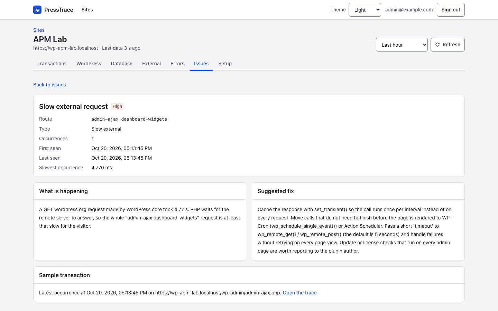
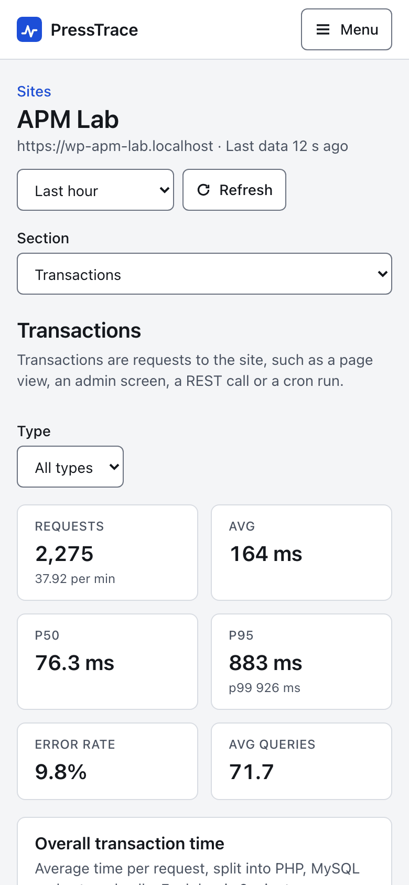

# PressTrace

PressTrace is a self-hosted, source-available APM for WordPress. A plugin measures each request, and an app on your own server shows which plugins, hooks, database queries and external calls make a site slow. It needs no PHP extension.

[](https://github.com/onwp/presstrace-wordpress-apm/actions/workflows/ci.yml)
[](https://onwp.github.io/presstrace-wordpress-apm/)
[](https://github.com/onwp/presstrace-wordpress-apm/releases/latest)
[](#licensing)



<table>
  <tr>
    <td><a href="docs-site/public/screenshots/trace.png"></a></td>
    <td><a href="docs-site/public/screenshots/wordpress.png"></a></td>
    <td><a href="docs-site/public/screenshots/issue-detail.png"></a></td>
    <td width="14%"><a href="docs-site/public/screenshots/transactions-mobile.png"></a></td>
  </tr>
  <tr>
    <td>Trace</td>
    <td>Plugins and hooks</td>
    <td>Issue detail</td>
    <td>Mobile</td>
  </tr>
</table>

## Features

For each traced request, PressTrace records:

- The transaction name and type: template, wp-admin screen, REST route, admin-ajax or wc-ajax action, cron, login or XML-RPC.
- Total time split into PHP, MySQL and external HTTP, plus query count, peak memory and HTTP status.
- Every `$wpdb` query with its duration, rows, errors and the plugin or theme that ran it. Queries of 1 ms or more get a stack trace.
- External calls made through the WordPress HTTP API.
- How long each plugin, must-use plugin and the theme takes to load, hook callbacks of 1 ms or more, and the self time of each plugin and theme.
- PHP warnings, notices, deprecations, errors, uncaught exceptions and fatals, with the plugin or theme they come from.

The app groups this data per site and raises issues such as N+1 queries, slow plugins, slow or failed external calls and high memory use, each with a suggested fix. The [issues reference](https://onwp.github.io/presstrace-wordpress-apm/issues/) lists every rule. One app can monitor many sites, and the dashboard works on a phone.

## Quick start

You need a server with Docker and Compose and about 2 GB of RAM. The WordPress sites must be able to reach it over HTTP.

### 1. Start the app

Download the app bundle from the [latest release](https://github.com/onwp/presstrace-wordpress-apm/releases/latest). It holds `docker-compose.yml`, `.env.example` and the ClickHouse config.

```sh
VERSION=0.1.0
curl -fsSLO "https://github.com/onwp/presstrace-wordpress-apm/releases/download/v$VERSION/presstrace-app-$VERSION.tar.gz"
tar -xzf "presstrace-app-$VERSION.tar.gz"
cd presstrace-app
cp .env.example .env
sed -i.bak \
  -e "s|^ADMIN_PASSWORD=.*|ADMIN_PASSWORD=$(openssl rand -base64 18)|" \
  -e "s|^SESSION_SECRET=.*|SESSION_SECRET=$(openssl rand -hex 32)|" \
  -e "s|^CLICKHOUSE_PASSWORD=.*|CLICKHOUSE_PASSWORD=$(openssl rand -hex 16)|" \
  .env
grep '^ADMIN_PASSWORD=' .env    # your dashboard password
```

Then open `.env` and set `ADMIN_EMAIL` to your sign-in email and `PUBLIC_URL` to the address your WordPress sites will use to reach the app, for example `https://apm.example.com`. Start it:

```sh
docker compose up -d
```

Compose pulls `ghcr.io/onwp/presstrace` and ClickHouse, and the app listens on port 8080.

The port is published on `127.0.0.1` only (`APP_BIND` in `.env`). On your own machine, open http://localhost:8080. On a remote server, put a reverse proxy with HTTPS in front of it, as shown in [HTTPS and reverse proxy](https://onwp.github.io/presstrace-wordpress-apm/app/https), and set `TRUST_PROXY=true`. To reach the port directly without a proxy, for example on a private network, set `APP_BIND=0.0.0.0` and run `docker compose up -d` again. Without HTTPS the password, session cookie and site keys cross the network in clear text.

To build the image from source instead, clone this repository and run the same steps in `app/`, with `docker compose up -d --build`.

### 2. Connect a WordPress site

1. Sign in to the app, click **Add site**, and copy the two `define()` lines it shows.
2. Download `presstrace-<version>.zip` from the same release. In WordPress, go to **Plugins > Add New > Upload Plugin**, upload it and activate it.
3. Paste the lines into `wp-config.php`, above `/* That's all, stop editing! */`:

   ```php
   define( 'PRESSTRACE_APP_URL', 'https://apm.example.com' );
   define( 'PRESSTRACE_SITE_KEY', 'pt_...' );
   ```

   You can enter the same values in **Tools > PressTrace** instead.
4. In **Tools > PressTrace**, click **Test connection**, turn on monitoring, and load a few pages. They then show up in the app.

The [quick start guide](https://onwp.github.io/presstrace-wordpress-apm/guide/quick-start) walks through the same steps with more detail. New plugin releases show up on the WordPress Plugins screen like any other update.

## Configuration

The app is configured through `.env`. Every variable, its default and allowed values are listed in [app configuration](https://onwp.github.io/presstrace-wordpress-apm/app/configuration). Upgrades, backups and retention are covered in [operations](https://onwp.github.io/presstrace-wordpress-apm/app/operations).

The plugin is configured in **Tools > PressTrace** or with `wp-config.php` constants, which suit hosting fleets. See [wp-config constants](https://onwp.github.io/presstrace-wordpress-apm/plugin/constants).

## Requirements

- Plugin: PHP 7.4 or newer and WordPress 6.0 or newer, tested up to 7.1. No PHP extension.
- App: Docker with Compose, about 2 GB of RAM with the default memory limits, and a port the WordPress servers can reach. Use HTTPS in production.

## Overhead

Measured in the lab on a page that takes about 60 ms without PressTrace:

| State | Added time per request |
|---|---|
| Monitoring off or request not sampled | about 0 to 3 ms |
| Request traced | about 9 to 12 ms |

The report is sent after the response, so visitors do not wait for it. A sample rate of 0.1 keeps the cost low on busy sites. See [overhead](https://onwp.github.io/presstrace-wordpress-apm/reference/overhead).

## How it works

```text
WordPress site + PressTrace plugin
        |
        |  one gzipped JSON report per traced request,
        |  sent to the app after the response is delivered
        |  (use HTTPS in production)
        v
PressTrace app (Node.js: ingest API + dashboard)
        |
        v
ClickHouse
```

The plugin stays dormant until it has an app URL and site key, monitoring is on, and the request is picked by the sample rate. It installs a must-use plugin so it starts before other plugins, and a `db.php` drop-in to time queries when no other `db.php` exists. Trace data never goes into the WordPress database. [docs/architecture.md](docs/architecture.md) explains the parts, the data model and the main design choices.

## Known limitations

- Queries that bypass `$wpdb` and HTTP calls that bypass the WordPress HTTP API are not recorded as spans. Their time still shows in the self time of the plugin that made them.
- Reports are not queued or retried. If the app is down, that data is lost.
- One admin login, no alerts or notifications, no export to other APM tools, and no network-wide agent for multisite.
- Requests served from a full page cache never reach WordPress, so they are not traced.

The full list is on [known limitations](https://onwp.github.io/presstrace-wordpress-apm/reference/limitations).

## Documentation

The documentation is at https://onwp.github.io/presstrace-wordpress-apm/. Each part of the repository also has its own README:

| Path | What it is |
|---|---|
| [`app/`](app/README.md) | The self-hosted app: Hono server, React dashboard, ClickHouse, Docker Compose. |
| [`plugin/presstrace/`](plugin/presstrace/README.md) | The WordPress plugin. |
| [`docs-site/`](docs-site/README.md) | The documentation site (VitePress). |
| [`docs/`](docs/README.md) | Architecture notes and the security audit. |
| [`dev/lab-scenarios/`](dev/lab-scenarios/README.md) | A development plugin that makes requests slow or broken on purpose. |
| [`bin/`](bin/) | `build-plugin.sh` builds `dist/presstrace-<version>.zip`; `bump-version.sh` sets the release version. |

## Contributing

Bug reports, fixes and docs changes are welcome. [CONTRIBUTING.md](CONTRIBUTING.md) covers the dev setup, the WordPress lab and how to run each test suite. For questions, see [SUPPORT.md](SUPPORT.md). Everyone taking part follows the [code of conduct](CODE_OF_CONDUCT.md).

## Security

Please report security problems privately, as described in [SECURITY.md](SECURITY.md), not in a public issue.

## Licensing

PressTrace is source-available. It is not open source in the OSI sense: you can read the code, but the license limits how you use it.

- The app, the dashboard, the docs, the scripts and everything else outside the two WordPress plugins are under the [PolyForm Strict License 1.0.0](LICENSE). You may use PressTrace for free for personal and other noncommercial purposes. You may not redistribute it, sell it, white-label it or make modified versions of it.
- The WordPress plugin in [`plugin/presstrace/`](plugin/presstrace/) is under the GNU General Public License, version 2 or (at your option) any later version. See [plugin/presstrace/LICENSE](plugin/presstrace/LICENSE). The development plugin in [`dev/lab-scenarios/`](dev/lab-scenarios/) is under the same license.
- The PressTrace name and logo are reserved, including for forks of the GPL plugin. See [TRADEMARKS.md](TRADEMARKS.md).

Commercial use needs a separate license. That includes a company running PressTrace internally to monitor its own sites. To ask about one, contact the author through the GitHub profile at https://github.com/onwp.

Copyright 2026 Serhat Aksakal.
