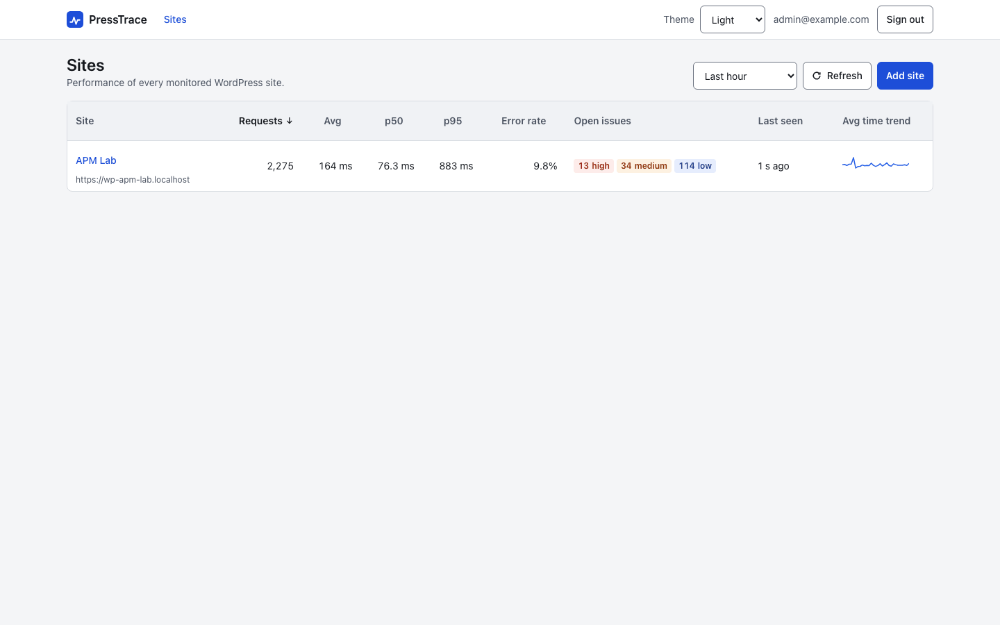

# PressTrace app

The self-hosted half of [PressTrace](../README.md). It receives reports from the WordPress plugin, stores them in ClickHouse and serves the dashboard. One app can monitor many sites.

It runs as two containers: `app` (a Node.js 24 server built with Hono, serving the ingest API and a React dashboard) and `clickhouse` (the official ClickHouse image).



## Run it with Docker Compose

```sh
cp .env.example .env    # set ADMIN_PASSWORD, SESSION_SECRET, CLICKHOUSE_PASSWORD and PUBLIC_URL
```

Then pick one:

```sh
docker compose up -d           # pull ghcr.io/onwp/presstrace:${PRESSTRACE_VERSION:-latest}
docker compose up -d --build   # build the image from the source in this folder
```

Open `PUBLIC_URL` (by default http://localhost:8080; Compose publishes the port on `127.0.0.1` only unless you set `APP_BIND`) and sign in with `ADMIN_EMAIL` and `ADMIN_PASSWORD`. `GET /healthz` answers `200` when the app can reach ClickHouse.

If you do not want to clone the repository, each [release](https://github.com/onwp/presstrace/releases) has a `presstrace-app-<version>.tar.gz` with `docker-compose.yml`, `.env.example` and the ClickHouse config. Unpack it and run `docker compose up -d`.

More on running it: [install the app](https://onwp.github.io/presstrace/app/), [HTTPS with a reverse proxy](https://onwp.github.io/presstrace/app/https), [upgrades, backups and retention](https://onwp.github.io/presstrace/app/operations) and [troubleshooting](https://onwp.github.io/presstrace/app/troubleshooting).

## Environment variables

Set these in `.env`. The full list with validation rules is on [environment variables](https://onwp.github.io/presstrace/app/configuration).

| Variable | Default | Required | What it does |
|---|---|---|---|
| `ADMIN_EMAIL` | `admin@example.com` | No | Email of the single dashboard login. |
| `ADMIN_PASSWORD` | none | Yes | Dashboard password, at least 12 characters. Placeholders and well-known weak passwords are refused. `openssl rand -base64 18` |
| `SESSION_SECRET` | none | Yes | Signs the session cookie, at least 32 characters. `openssl rand -hex 32` |
| `PUBLIC_URL` | `http://localhost:8080` | In practice | Address that WordPress sites and browsers use to reach the app. |
| `APP_PORT` | `8080` | No | Host port that Compose publishes. |
| `APP_BIND` | `127.0.0.1` | No | Host address the port is published on. Set `0.0.0.0` when WordPress servers on other hosts connect without a proxy. |
| `TRUST_PROXY` | `false` | No | Set to `true` behind a reverse proxy that sets `X-Forwarded-For`. |
| `TRANSACTIONS_TTL_DAYS` | `30` | No | Days to keep transactions, issues and errors. |
| `SPANS_TTL_DAYS` | `7` | No | Days to keep spans. |
| `CLICKHOUSE_DATABASE`, `CLICKHOUSE_USER` | `presstrace` | No | ClickHouse database and user. |
| `CLICKHOUSE_PASSWORD` | none | Yes | ClickHouse password. `openssl rand -hex 16` |
| `CLICKHOUSE_MEM_LIMIT`, `APP_MEM_LIMIT` | `1200m`, `384m` | No | Container memory limits, sized for a 2 GB server. |
| `BUFFER_MAX_MB` | `64` | No | Report data the app keeps in memory while ClickHouse is slow or down. |
| `INGEST_RATE_PER_SITE`, `INGEST_BURST_PER_SITE` | `20`, `100` | No | Reports per second per site, and the burst on top. `0` turns the rate limit off. |
| `ENABLE_DEBUG_ROUTES` | `false` | No | Adds `/api/v1/debug/delay` for the development lab. |
| `PRESSTRACE_VERSION` | `latest` (`0.1.0` in `.env.example`) | No | Image tag that `docker compose up -d` pulls. |

## Development

You need Node.js 24 and pnpm 10 (`corepack enable`).

```sh
pnpm install
pnpm dev          # API server with reload on port 8080 (needs ClickHouse and the variables above)
pnpm dev:web      # Vite on port 5173, proxies /api to port 8080
pnpm build        # dashboard to dist/web, server bundled to dist/server/index.js
pnpm start        # run the bundle
pnpm typecheck
```

Tests use Vitest:

```sh
pnpm test                                               # unit tests, no services needed
docker compose -f docker-compose.test.yml up -d --wait  # throwaway ClickHouse on port 18123
pnpm test:integration
E2E_BASE_URL=http://localhost:8080 E2E_ADMIN_EMAIL=admin@example.com E2E_ADMIN_PASSWORD=... pnpm test:e2e
```

The integration tests create a new database on each run. `CLICKHOUSE_TEST_URL`, `CLICKHOUSE_TEST_USER` and `CLICKHOUSE_TEST_PASSWORD` override the defaults. The end-to-end tests drive a running app with Playwright and run an axe accessibility check on every page. Set `E2E_SCREENSHOT_DIR` to keep their screenshots.

See [development](https://onwp.github.io/presstrace/reference/development) for running the app against the ddev lab.

## Project structure

| Path | What it is |
|---|---|
| `src/server/` | Hono server: ingest and payload validation, auth, ClickHouse access and migrations, issue detection, dashboard queries. Entry point `index.ts`. |
| `src/web/` | React dashboard. One file per page in `pages/`. |
| `src/shared/` | Types and time range helpers shared by server and dashboard. |
| `clickhouse/` | ClickHouse server and user settings, mounted by both compose files. |
| `test/` | `unit/`, `integration/`, `e2e/` and payload fixtures. |
| `Dockerfile` | Two-stage build. The runtime image holds only the bundled `dist/`. |
| `docker-compose.yml` | The production stack. |
| `docker-compose.test.yml` | ClickHouse for the integration tests. |

## API

The plugin talks to `POST /api/v1/ingest` and `GET /api/v1/ping` with its site key. The dashboard uses session-authenticated JSON endpoints under `/api/`. Both are listed on [API endpoints](https://onwp.github.io/presstrace/reference/api), and the report format is on [payload format](https://onwp.github.io/presstrace/reference/payload).
