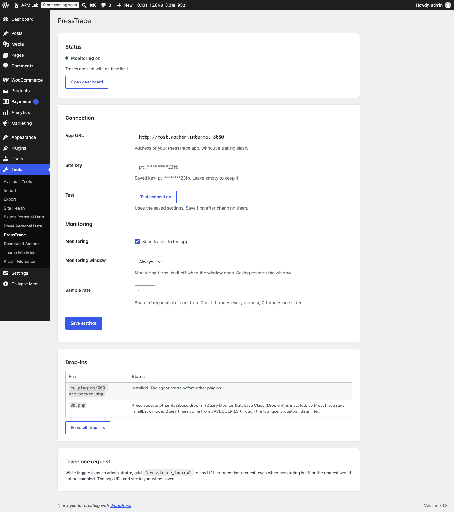

# PressTrace plugin

The WordPress agent of [PressTrace](../../README.md). It measures each traced request and sends one report to your [PressTrace app](../../app/README.md) after the page is delivered. It is pure PHP, needs no extension, and stores only its settings in the site database.

Requires PHP 7.4 or newer and WordPress 6.0 or newer. Tested up to WordPress 7.1. The `readme.txt` next to this file is the WordPress.org style readme that ships in the zip.



## What it captures

- Transaction name and type: front-end template, wp-admin screen, REST route, admin-ajax and wc-ajax action, cron, login, XML-RPC.
- Total time, MySQL time, external HTTP time, query and call counts, peak memory and HTTP status.
- Every `$wpdb` query with duration, rows, error and the calling plugin or theme. Queries of 1 ms or more get a stack trace of up to 15 frames.
- External calls made through the WordPress HTTP API.
- Load time of each plugin, must-use plugin and the active theme.
- Plugin and theme hook callbacks of 1 ms or more, and the self time of every plugin and theme.
- PHP warnings, notices, deprecations, errors, uncaught exceptions and fatal errors, with the component they come from.

Nothing is traced until the plugin has an app URL and a site key, monitoring is on and inside its window (2, 4, 12 or 24 hours, or always), and the request is picked by the sample rate. An administrator can trace one request on demand with `?presstrace_force=1`.

## Install

1. Download `presstrace-<version>.zip` from the [GitHub releases](https://github.com/onwp/presstrace-wordpress-apm/releases).
2. In WordPress, go to **Plugins > Add New > Upload Plugin**, upload the zip and activate it. With WP-CLI: `wp plugin install presstrace-<version>.zip --activate`.
3. Add the site in the app and copy its app URL and site key.
4. Enter them in **Tools > PressTrace**, or set the constants below. Click **Test connection**, then turn on monitoring.

## Updates

The plugin header sets `Update URI: https://github.com/onwp/presstrace-wordpress-apm`. WordPress then never offers a WordPress.org plugin with the same slug as an update. PressTrace answers the update check itself: it reads the latest stable release from the GitHub API (cached for 12 hours) and offers its `presstrace-<version>.zip` on the Plugins screen. Prereleases are skipped. Set `PRESSTRACE_DISABLE_UPDATE_CHECK` to `true` to turn the check off and update by hand.

Details: [install and connect](https://onwp.github.io/presstrace-wordpress-apm/plugin/) and the [settings page](https://onwp.github.io/presstrace-wordpress-apm/plugin/settings).

## wp-config constants

Constants override the settings page, which suits hosting fleets. Put them above `/* That's all, stop editing! */`.

| Constant | Type | What it does |
|---|---|---|
| `PRESSTRACE_APP_URL` | string | App URL, `http://` or `https://`. |
| `PRESSTRACE_SITE_KEY` | string | Site key: `pt_` followed by 40 hex characters. |
| `PRESSTRACE_SAMPLE_RATE` | number | Share of requests to trace, 0 to 1. |
| `PRESSTRACE_ALWAYS_ON` | bool | Keeps monitoring on with no window. |
| `PRESSTRACE_TRACE_CLI` | bool | Also traces WP-CLI commands. Off by default. |
| `PRESSTRACE_DISABLE_UPDATE_CHECK` | bool | Stops the update check against GitHub releases. |

```php
define( 'PRESSTRACE_APP_URL', 'https://apm.example.com' );
define( 'PRESSTRACE_SITE_KEY', 'pt_0123456789abcdef0123456789abcdef01234567' );
define( 'PRESSTRACE_SAMPLE_RATE', 0.1 );
define( 'PRESSTRACE_ALWAYS_ON', true );
```

See [wp-config constants](https://onwp.github.io/presstrace-wordpress-apm/plugin/constants).

## Drop-ins and Query Monitor

On activation the plugin writes two files, and removes them on deactivation if they are still its own:

- `wp-content/mu-plugins/000-presstrace.php` starts the agent before other plugins, so plugin load times can be measured.
- `wp-content/db.php` times every query. It is only written when no other `db.php` exists.

If another `db.php` is installed, PressTrace leaves it alone and falls back. With Query Monitor it reads query timings through Query Monitor's `log_query_custom_data` filter, so both plugins work together. With other drop-ins, query times come from `SAVEQUERIES` when it is on; otherwise queries are only counted.

Hook callbacks are wrapped in place, so `remove_action()`, `remove_filter()` and `has_filter()` keep working. See [drop-ins and compatibility](https://onwp.github.io/presstrace-wordpress-apm/plugin/drop-ins).

## Filters

| Filter | Use |
|---|---|
| `presstrace_should_trace( bool $trace, array $context )` | Skip a request. Runs very early, so only `wp-config.php` or an mu-plugin that loads before `000-presstrace.php` can use it. |
| `presstrace_transaction_name( string $name, string $type, array $context )` | Rename a transaction. |
| `presstrace_payload( array $payload )` | Change the report before it is sent, or return a non-array to drop it. |

Examples are on [filters for developers](https://onwp.github.io/presstrace-wordpress-apm/plugin/developers).

## Overhead

In the lab, on a page that takes about 60 ms without PressTrace, an untraced request costs about 0 to 3 ms and a traced one about 9 to 12 ms. The report is sent after the response with a 2 second timeout. After a failed send the agent skips sending for 60 seconds, so an app outage does not tie up PHP workers. See [overhead](https://onwp.github.io/presstrace-wordpress-apm/reference/overhead).

## Development

```sh
composer install
composer test          # PHPUnit
composer lint          # PHP_CodeSniffer: WordPress-Extra and PHPCompatibilityWP for PHP 7.4+
```

The tests need no WordPress or database. After changing translatable strings, regenerate the translation template with WP-CLI:

```sh
wp i18n make-pot . languages/presstrace.pot --slug=presstrace --exclude=vendor,tests
```

To build the release zip, run `bin/build-plugin.sh` from the repository root. It writes `dist/presstrace-<version>.zip` with only the runtime files. For a full WordPress to try changes in, see the ddev lab in [CONTRIBUTING.md](../../CONTRIBUTING.md) and the [lab scenarios plugin](../../dev/lab-scenarios/README.md).

| Path | What it is |
|---|---|
| `presstrace.php` | Plugin header and bootstrap. |
| `src/` | Agent classes: settings, hooks, database and HTTP capture, errors, naming, payload. |
| `dropins/` | Templates for the loader mu-plugin and `db.php`. |
| `languages/` | Translation template (`presstrace.pot`). |
| `tests/` | PHPUnit tests and fixtures. |

## Limitations

- Queries that bypass `$wpdb` (direct mysqli or PDO) and HTTP calls that bypass the WordPress HTTP API (raw cURL, Guzzle, `file_get_contents()`) are not recorded as spans. Their time shows in the self time of the plugin that made them.
- Core hook callbacks and callbacks that take arguments by reference are not timed one by one.
- Code that reads `WP_Hook::$callbacks` directly sees PressTrace wrapper objects on traced requests. `get_wrapped_callback()` returns the original.
- Reports are not queued or retried.

See [known limitations](https://onwp.github.io/presstrace-wordpress-apm/reference/limitations).

## License

The plugin is free software under the GNU General Public License, version 2 or (at your option) any later version. See [LICENSE](LICENSE). The rest of the repository, including the app, is under a different license; see [Licensing](../../README.md#licensing). The PressTrace name and logo are not covered by the GPL; see [TRADEMARKS.md](../../TRADEMARKS.md).
